<div align="center">


<br/>

<a href="https://www.linkedin.com/in/rithikasr/"></a>
<a href="mailto:sankarrajeswari.r@northeastern.edu"></a>
<a href="https://scholar.google.com/citations?hl=en&user=8g7kV8UAAAAJ"></a>
<a href="https://drive.google.com/file/d/1NsJ-LZnl5t-RPJD-uQYFTJWs9fKf1LSe/view?usp=sharing"></a>

</div>

---

### `01` / `whoami`

```python
class Rithika:
    role         = "Data Scientist · ML/AI Engineer · Data Engineer · Analyst"
    based_in     = "Boston, MA (ready to relocate)"
    studying     = "M.S. Data Analytics Engineering @ Northeastern · Dec 2026"
    teaching     = "TA · Deep Learning for AI"
    open_to      = "full-time roles starting Jan 2027"
    fun_fact     = "ECE undergrad, so I still see every dataset as signal vs. noise"

    def debug(self, problem):
        return "it's always the data. it's literally always the data."
```

### `02` / by the numbers

<div align="center">


</div>

### `03` / how I can help your team

<table>
<tr>
<td width="50%" valign="top">

<h3>🔬 Data Science</h3>

I design experiments that answer the question the business is *actually* asking. That means A/B tests, hypothesis testing and statistical models, plus unsupervised methods when the data has no labels. At Intuitive, I clustered 1,100+ real user queries with embeddings, UMAP and HDBSCAN to surface hidden product gaps.

   

</td>
<td width="50%" valign="top">

<h3>🤖 ML / AI Engineering</h3>

I build RAG systems *and* the evaluation frameworks that prove they work: synthetic test sets, precision/recall and LLM-as-judge scoring. I've fine-tuned LLaMA, built agentic workflows, and wired up MLflow and drift monitoring so models stay healthy after launch, not just on demo day.

   

</td>
</tr>
<tr>
<td width="50%" valign="top">

<h3>🏗️ Data Engineering</h3>

I build pipelines teams can trust, using PySpark, AWS Glue and Airflow, with schema validation and data-quality checks built in from the start. At Medlaunch, this cut data-related pipeline failures by **30%**, and field-level masking kept sensitive healthcare data compliant.

   

</td>
<td width="50%" valign="top">

<h3>📊 Analytics & BI</h3>

I write SQL across Snowflake, BigQuery and PostgreSQL, define KPIs that mean something, and build dashboards people actually open. My favorite part is the last step: turning an analysis into a clear recommendation that product, engineering or client teams can act on.

   

</td>
</tr>
</table>

### `04` / experience

| When | Where | What I did |
| :--- | :--- | :--- |
| **Sep 2026 – Present** | 🏛️ **Northeastern University**<br/><sub>Teaching Assistant · Deep Learning for AI</sub> | Guide grad students through model development, error analysis and evaluation of deep learning architectures |
| **Jun – Aug 2026** | 🤖 **Intuitive Surgical**<br/><sub>AI/ML Data Scientist · Sunnyvale, CA</sub> | Built a RAG evaluation framework; clustered 1,100+ production queries to uncover product gaps and inform the AI roadmap |
| **Jan – May 2026** | 🏥 **Medlaunch Concepts**<br/><sub>Data Engineer · Clearwater, FL</sub> | Built PySpark + AWS Glue pipelines with automated schema validation; cut data-related failures by 30% |
| **Aug 2021 – Aug 2022** | 📡 **Flare Innovations**<br/><sub>Data Science Intern · India</sub> | Ran statistical analysis on sensor telemetry; built Streamlit KPI dashboards for stakeholders |

### `05` / currently building

> **🔎 Agentic Retrieval Lab**: a hands-on study of how retrieval really behaves, inspired by Perplexity's Q2D-Web paper. It includes a mini query-to-document benchmark, a BM25-hybrid vs. all-neural fusion test, and a retrieval failure analyzer.

<div align="center">

<a href="https://github.com/rithika-sr?tab=repositories"></a>

<sub>📌 pinned repos below: one for each kind of work I do</sub>

</div>

### `06` / toolbox

<div align="center">

<sub><b>── LANGUAGES & ANALYSIS ──</b></sub><br/>


<sub><b>── AI / ML ──</b></sub><br/>


<sub><b>── DATA ENGINEERING ──</b></sub><br/>


<sub><b>── ANALYTICS & BI ──</b></sub><br/>


<sub><b>── CLOUD & DEVOPS ──</b></sub><br/>


</div>

---

<div align="center">
<b>Clean data. Honest metrics. AI that actually ships.</b>
<br/>
<sub>Hiring for a data or AI team? <a href="mailto:sankarrajeswari.r@northeastern.edu">Let's talk →</a></sub>
</div>


