<!-- ===================== HEADER ===================== -->


<div align="center">

<a href="https://git.io/typing-svg">
  
</a>

<br/>

<a href="https://www.linkedin.com/in/rithika-s-r"></a>
<a href="mailto:sankarrajeswari.r@northeastern.edu"></a>
<a href="https://scholar.google.com/citations?hl=en&user=8g7kV8UAAAAJ"></a>
<a href="RESUME_LINK_HERE"></a>


</div>

---

### `01` / `whoami`

```python
class Rithika:
    role          = "Data Scientist · AI Engineer · Data Engineer"
    based_in      = "Boston, MA  (ready to relocate)"
    studying      = "M.S. Data Analytics Engineering @ Northeastern → Dec 2026"
    teaching      = "TA · IE 7615 Deep Learning for AI"
    obsessed_with = ["RAG evaluation", "retrieval quality",
                     "agentic workflows", "pipelines that don't break at 3am"]
    looking_for   = "full-time DS / ML / AI / Data Eng roles · starting Jan 2027"
    fuel          = "☕ ☕ ☕"

    def ask(self, question: str) -> str:
        return "great question. let's measure it first."
```

### `02` / model card

<details open>
<summary><b>📋 rithika-sr · v2026.11</b> &nbsp;<sub>(click to collapse)</sub></summary>

```yaml
model:          rithika-sr
architecture:   ECE undergrad → data science → applied AI
intended_use:   teams who want AI systems that actually work (and can prove it)

training_data:
  - Intuitive Surgical:   RAG eval framework · LLM-as-judge · precision/recall
  - Intuitive Surgical:   1,100+ production queries → UMAP + HDBSCAN clusters
  - Medlaunch Concepts:   PySpark + AWS Glue pipelines · schema validation
  - Flare Innovations:    sensor telemetry · hypothesis testing · dashboards
  - Northeastern:         Deep Learning TA · MLOps · Agentic AI

eval_results:
  pipeline_failures:      -30%
  production_queries:     1,100+ analyzed
  peer_reviewed_papers:   7
  mlops_expo_google:      🥉 3rd place
  hallucination_rate:     currently grounding yours

known_limitations:
  - will ask "but how are we measuring that?" in every meeting
  - cannot resist an unlabeled dataset
```

</details>

### `03` / the journey so far

```mermaid
flowchart LR
    A["📊 Flare Innovations<br/>DS Intern · 2021"] --> B["🎓 Anna University<br/>B.E. ECE · 2024"]
    B --> C["🏛️ Northeastern<br/>M.S. DAE · 2024"]
    C --> D["🥉 Google MLOps Expo<br/>Charlie · 2025"]
    D --> E["🏥 Medlaunch Concepts<br/>Data Engineer · 2026"]
    E --> F["🤖 Intuitive Surgical<br/>AI/ML Data Scientist · 2026"]
    F --> G["👩‍🏫 Teaching Assistant<br/>Deep Learning · 2026"]
    G --> H(["✨ your team?<br/>Jan 2027"])

    classDef past fill:#EDE9FE,stroke:#A78BFA,color:#3B0764
    classDef next fill:#7C3AED,stroke:#C4B5FD,stroke-width:3px,color:#FFFFFF
    class A,B,C,D,E,F,G past
    class H next
```



### `04` / on my workbench

<table>
<tr>
<td width="50%" valign="top">

#### 👗 Stella
**AI fashion stylist, grounded in real inventory**

A RAG chatbot that matches what you *say* ("something for a rooftop dinner, not too formal") to what's *actually in stock*. No hallucinated outfits.


<details>
<summary>under the hood ↓</summary>
<br>

- Retrieval grounded in live product inventory
- LLaMA fine-tuned on domain-specific fashion dialogue
- Semantic search that maps free-text requests to structured attributes

</details>

</td>
<td width="50%" valign="top">

#### 📡 Charlie
**Real-time telemetry + A/B experimentation engine**

Streams millions of interaction events, powers online A/B tests, and flags drift before it becomes a problem.<br/>**🥉 3rd place · MLOps Expo @ Google Cambridge**


<details>
<summary>under the hood ↓</summary>
<br>

- Streaming pipeline with baseline metrics for online experiments
- Automated drift detection with Evidently AI
- Model monitoring across deployment cycles with MLflow

</details>

</td>
</tr>
</table>

<!-- Optional: swap in live repo cards once your repos are public
<a href="https://github.com/YOUR_GITHUB_USERNAME/STELLA_REPO"></a>
-->

### `05` / tools I reach for

<div align="center">


<br/>


<br/><br/>


</div>

<details>
<summary><b>open the full toolbox ↗</b></summary>
<br>

| | |
| :--- | :--- |
| 🧪 **Analysis & experimentation** | Pandas · NumPy · SciPy · scikit-learn · hypothesis testing · A/B testing · online metrics |
| 🔍 **AI evaluation** | RAG eval pipelines · LLM-as-judge · precision/recall · embeddings · UMAP · HDBSCAN |
| 🏗️ **Data & infrastructure** | PySpark · AWS Glue · ETL/ELT · data modeling · schema validation · data quality |
| 🚀 **Deployment & MLOps** | FastAPI · Docker · CI/CD · MLflow · Evidently AI · Vertex AI |

</details>

### `06` / live from the terminal

<div align="center">


<picture>
  <source media="(prefers-color-scheme: dark)" srcset="https://raw.githubusercontent.com/YOUR_GITHUB_USERNAME/YOUR_GITHUB_USERNAME/output/github-snake-dark.svg" />
  <source media="(prefers-color-scheme: light)" srcset="https://raw.githubusercontent.com/YOUR_GITHUB_USERNAME/YOUR_GITHUB_USERNAME/output/github-snake.svg" />
  
</picture>

</div>

---

<div align="center">

<sub>7 research publications · a soft spot for hard problems · always learning</sub>

<br/>

<i>Good questions. Thoughtful experiments. Useful things.</i>

</div>


